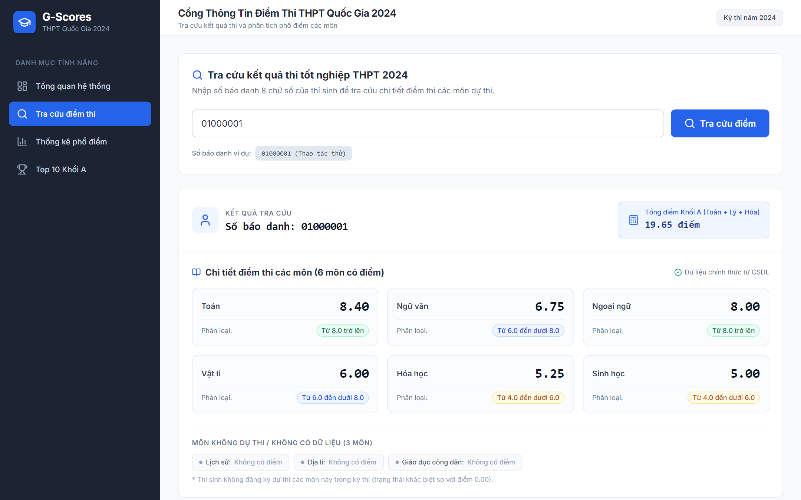
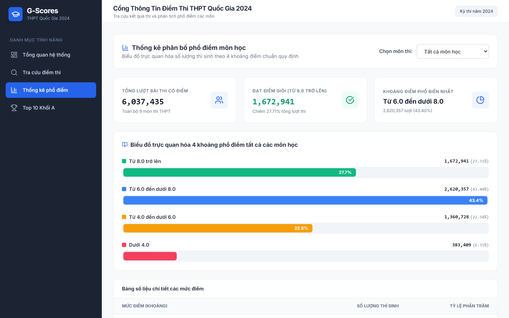
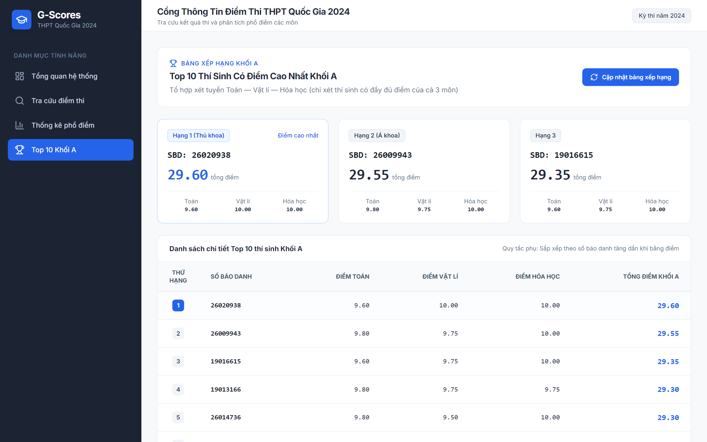
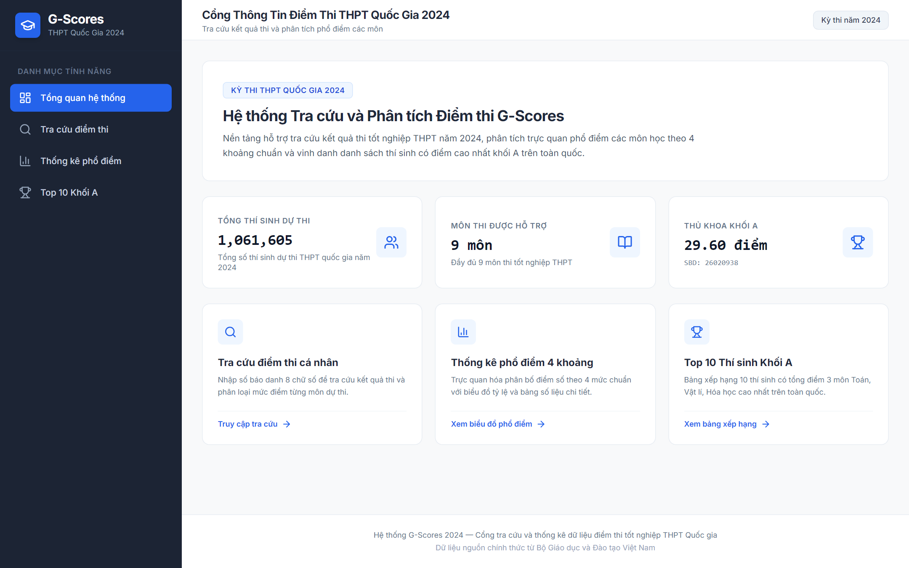

# G-Scores — Tra cứu và Phân tích Phổ điểm Thi THPT 2024

- **Live:** https://g-scores-amber.vercel.app
- **API Health:** https://g-scores-amber.vercel.app/api/v1/health

## 1. Chức năng chính

- **Tra cứu điểm thi:** Tra cứu kết quả cá nhân bằng số báo danh 8 chữ số, hiển thị điểm từng môn và tổng điểm tổ hợp Khối A khi đủ dữ liệu.



- **Phân tích phổ điểm:** Trực quan hóa số lượng và tỷ lệ thí sinh theo 4 khoảng điểm, hỗ trợ xem từng môn hoặc toàn bộ môn thi.



- **Xếp hạng Khối A:** Hiển thị Top 10 thí sinh theo tổng điểm Toán, Vật lí và Hóa học; sử dụng số báo danh tăng dần làm tiêu chí phụ khi đồng điểm.



- **Tổng quan hệ thống:** Hiển thị dashboard tổng quan



## 2. Công nghệ sử dụng

| Thành phần                    | Công nghệ                                   |
| ----------------------------- | ------------------------------------------- |
| Backend                       | Python 3.12, FastAPI, Pydantic v2           |
| ORM và kết nối database       | SQLAlchemy 2.0, SQLAlchemy AsyncIO, asyncpg |
| Frontend                      | React 18, TypeScript, Vite, Tailwind CSS    |
| Database                      | PostgreSQL 16                               |
| Cache                         | Redis 7, Upstash                            |
| Kiểm thử và kiểm tra mã nguồn | Pytest, pytest-asyncio, HTTPX, Ruff         |
| Đóng gói và triển khai        | Docker, Docker Compose, Vercel              |

## 3. Điểm nhấn kỹ thuật

- **Domain Model theo OOP:** Tách biệt nghiệp vụ môn thi, khoảng điểm và tổ hợp môn khỏi tầng database và API schemas, hỗ trợ kiểm thử độc lập.
- **Bảng thống kê tính toán trước:** Lưu các chỉ số tổng quan và phổ điểm theo môn, hạn chế việc quét hơn một triệu bản ghi trong mỗi lượt truy cập.
- **Tối ưu truy vấn xếp hạng:** Sử dụng PostgreSQL B-tree expression index cho bảng xếp hạng Khối A, giúp truy vấn có thể đọc dữ liệu theo thứ tự từ index và loại bỏ bước `Sort` khi query planner lựa chọn kế hoạch này.
- **Cache-Aside và Graceful Degradation:** Cache các endpoint ít thay đổi với TTL 24 giờ; tự động chuyển sang truy vấn PostgreSQL khi Redis không khả dụng hoặc hết thời gian chờ.
- **Nạp dữ liệu theo batch:** Đọc CSV theo luồng và thực hiện bulk insert theo từng lô 4.000 bản ghi nhằm kiểm soát bộ nhớ và giảm số lần tương tác với database.

## 4. Cấu trúc dự án

- `backend/` — API, domain logic, truy cập database và các script xử lý dữ liệu.
- `frontend/` — Giao diện React được xây dựng bằng Vite.
- `docs/` — Tài liệu kiến trúc, pipeline dữ liệu và triển khai.
- `docker-compose.yml` — Cấu hình môi trường phát triển bằng Docker Compose.

## 5. Hướng dẫn khởi chạy

**Yêu cầu:** Python 3.12, Node.js, PostgreSQL 16 và Redis 7. Có thể sử dụng Docker Compose để khởi chạy môi trường phát triển.

### Bước 1: Cấu hình môi trường

```bash
cp .env.example .env
```

Cấu hình các biến môi trường kết nối database và Redis theo hướng dẫn trong repository.

### Bước 2: Khởi chạy dịch vụ

```bash
docker compose up -d --build
```

### Bước 3: Khởi tạo database và dữ liệu

```bash
docker compose exec backend alembic upgrade head
docker compose exec backend python scripts/import_scores.py
docker compose exec backend python scripts/aggregate_statistics.py --verify
```

Đảm bảo dữ liệu CSV nguồn đã được đặt đúng đường dẫn mà script import yêu cầu.

### Bước 4: Truy cập ứng dụng

- **Frontend:** http://localhost:5173
- **Backend API:** http://localhost:8000
- **Swagger UI:** http://localhost:8000/docs

Nếu không sử dụng Docker, xem hướng dẫn cấu hình tại [`docs/deployment.md`](docs/deployment.md).

## 6. Danh sách API

Tất cả endpoint sử dụng tiền tố `/api/v1`.

| Phương thức | Endpoint                        | Chức năng                                               |
| ----------- | ------------------------------- | ------------------------------------------------------- |
| `GET`       | `/health`                       | Kiểm tra trạng thái dịch vụ và các thành phần phụ thuộc |
| `GET`       | `/subjects`                     | Lấy danh sách môn thi                                   |
| `GET`       | `/scores/{registration_number}` | Tra cứu điểm theo số báo danh                           |
| `GET`       | `/reports/score-distribution`   | Lấy thống kê phổ điểm                                   |
| `GET`       | `/students/top-a`               | Lấy Top 10 thí sinh Khối A                              |
| `GET`       | `/students/total`               | Lấy tổng số thí sinh                                    |

Tài liệu API tương tác có tại `/docs` khi backend đang hoạt động.

## 7. Kiểm thử và chất lượng mã nguồn

Bộ kiểm thử backend gồm **28 bài test tự động**, bao phủ:

- Nghiệp vụ tính điểm và xử lý dữ liệu.
- Pipeline import CSV và chia batch.
- Cơ chế cache và xử lý khi Redis gặp sự cố.
- Truy vấn database và tính toàn vẹn của dữ liệu thống kê.
- API endpoints, HTTP status codes và response schemas.

Chạy kiểm thử và kiểm tra mã nguồn:

```bash
cd backend
pytest -v
ruff check .
```

## 8. Tài liệu kỹ thuật

- [`docs/architecture.md`](docs/architecture.md) — Kiến trúc hệ thống, quyết định thiết kế và trade-offs.
- [`docs/data-pipeline.md`](docs/data-pipeline.md) — Quy trình nạp, tổng hợp và đối soát dữ liệu.
- [`docs/deployment.md`](docs/deployment.md) — Cấu hình môi trường và triển khai ứng dụng.
