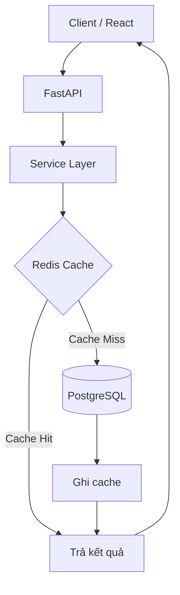

# Kiến trúc hệ thống G-Scores

## 1. Tổng quan

### Công nghệ chính

- **Backend:** Python 3.12, FastAPI, Pydantic v2, SQLAlchemy 2.0 Async.
- **Database:** PostgreSQL 16.
- **Cache:** Redis 7.
- **Frontend:** React 18, TypeScript, Vite, Tailwind CSS.
- **Deployment:** Vercel, Supabase PostgreSQL, Upstash Redis.

## 2. Sơ đồ kiến trúc



Luồng xử lý:

1. Client gửi request đến REST API.
2. Service Layer xử lý nghiệp vụ và kiểm tra Redis nếu endpoint hỗ trợ cache.
3. Khi cache hit, hệ thống trả dữ liệu đã lưu.
4. Khi cache miss, hệ thống truy vấn PostgreSQL và lưu kết quả vào Redis.
5. Nếu Redis gặp lỗi, hệ thống bỏ qua cache và sử dụng PostgreSQL trực tiếp.

Cache không thay thế PostgreSQL. PostgreSQL vẫn là nguồn dữ liệu chính thức.

## 3. Thiết kế dữ liệu

### Bảng `students`

Lưu thông tin thí sinh và điểm thi theo mô hình wide table: mỗi thí sinh tương ứng một bản ghi, các môn thi được lưu trong những cột riêng.

Các trường chính gồm:

- `sbd`: số báo danh, được lưu dưới dạng chuỗi để giữ nguyên định dạng.
- Các cột điểm: `toan`, `ngu_van`, `ngoai_ngu`, `vat_li`, `hoa_hoc`, `sinh_hoc`, `lich_su`, `dia_li`, `gdcd`.

Điểm chưa có được biểu diễn bằng `NULL`, không tự động chuyển thành `0`, nhằm phân biệt dữ liệu thiếu với điểm số thực tế.

**Lý do chọn wide table:** dữ liệu có cấu trúc cố định, chủ yếu phục vụ tra cứu theo số báo danh và thống kê theo môn. Cách lưu này giảm nhu cầu JOIN giữa nhiều bảng điểm khi thực hiện các truy vấn phổ biến.

### Bảng `system_metrics`

Lưu các chỉ số tổng hợp cấp hệ thống, chẳng hạn tổng số hồ sơ. Các giá trị đã được tính trước giúp tránh thực hiện `COUNT(*)` trên toàn bộ bảng `students` mỗi khi cần hiển thị số liệu tổng quan.

### Bảng `score_statistics`

Lưu số liệu thống kê theo môn học và khoảng điểm. API có thể đọc kết quả tổng hợp thay vì quét và nhóm toàn bộ dữ liệu gốc trong mỗi request.

Các bảng tổng hợp cần được cập nhật lại sau khi dữ liệu nguồn thay đổi.

## 4. Tối ưu truy vấn PostgreSQL

### Chỉ mục Top Group A

Truy vấn xếp hạng Group A00 sử dụng tổng điểm ba môn Toán, Vật lí và Hóa học. Để hỗ trợ truy vấn này, hệ thống sử dụng partial functional index:

```sql
CREATE INDEX idx_students_group_a_sum
ON students (
    (toan + vat_li + hoa_hoc) DESC,
    sbd ASC
)
WHERE toan IS NOT NULL
  AND vat_li IS NOT NULL
  AND hoa_hoc IS NOT NULL;
```

**Lợi ích thiết kế:**

- Index lưu giá trị biểu thức tổng điểm để hỗ trợ sắp xếp theo điểm Group A.
- Điều kiện `WHERE` loại các hồ sơ thiếu điểm một trong ba môn khỏi index.
- `sbd ASC` tạo tiêu chí sắp xếp phụ khi tổng điểm bằng nhau.

Index này hướng đến truy vấn lấy các thí sinh có tổng điểm cao nhất, đồng thời giảm lượng dữ liệu cần sắp xếp khi PostgreSQL có thể tận dụng index.

Hiệu quả thực tế phụ thuộc vào câu SQL, statistics của bảng và query planner. Có thể kiểm tra bằng:

```sql
EXPLAIN (ANALYZE, BUFFERS)
SELECT
    sbd,
    toan,
    vat_li,
    hoa_hoc,
    toan + vat_li + hoa_hoc AS total_score
FROM students
WHERE toan IS NOT NULL
  AND vat_li IS NOT NULL
  AND hoa_hoc IS NOT NULL
ORDER BY total_score DESC, sbd ASC
LIMIT 10;
```

Cần kiểm tra execution plan thực tế trước khi kết luận PostgreSQL đã sử dụng index hoặc loại bỏ thao tác Sort.

## 5. Redis Cache

G-Scores sử dụng mô hình **cache-aside**: ứng dụng chủ động đọc cache trước, truy vấn PostgreSQL khi cache miss và ghi kết quả trở lại Redis.

### Cache policy

| Thành phần    | Thiết kế                          |
| ------------- | --------------------------------- |
| Key           | Có namespace và version `v1`      |
| TTL           | 24 giờ                            |
| Redis timeout | 500 ms                            |
| Cache miss    | Truy vấn PostgreSQL               |
| Redis lỗi     | Bỏ qua cache, truy vấn PostgreSQL |

Các cache key chính:

- `students:total:v1`
- `reports:distribution:v1:{subject_code}`
- `students:top_a:v1:{limit}`

Namespace và version giúp phân biệt loại dữ liệu, tham số truy vấn và phiên bản cache. Khi thay đổi định dạng kết quả, có thể nâng version key để tránh đọc dữ liệu cache cũ.

### Xử lý lỗi và tính nhất quán

Redis là lớp tối ưu hiệu năng, không phải nguồn dữ liệu chính. Khi Redis không khả dụng hoặc xảy ra timeout, ứng dụng cần tiếp tục xử lý bằng PostgreSQL nếu database vẫn hoạt động.

TTL giúp giới hạn thời gian tồn tại của cache, nhưng không tự bảo đảm dữ liệu được cập nhật ngay sau khi nguồn thay đổi. Nếu dữ liệu được import hoặc tổng hợp lại, cần có cơ chế xóa cache hoặc thay đổi version key phù hợp.

Fallback sang PostgreSQL cũng có nghĩa là tải database có thể tăng khi Redis lỗi hoặc cache miss hàng loạt.

## 6. Tổ chức Backend

Backend được tổ chức theo trách nhiệm để tách HTTP handling khỏi nghiệp vụ và truy cập dữ liệu:

- **API / Router:** nhận request, kiểm tra tham số và trả HTTP response.
- **Service Layer:** điều phối nghiệp vụ, truy vấn dữ liệu và áp dụng cache policy.
- **Data Access:** thực hiện truy vấn PostgreSQL thông qua SQLAlchemy.
- **Domain Model:** biểu diễn các đối tượng nghiệp vụ liên quan đến thí sinh và điểm thi.
- **Pydantic Schemas:** xác thực dữ liệu đầu vào và định nghĩa cấu trúc response.

Cách tổ chức này giúp giới hạn trách nhiệm của từng thành phần và hỗ trợ kiểm thử độc lập. Domain Model và Pydantic Schemas có vai trò khác nhau: một bên phục vụ mô hình nghiệp vụ, bên còn lại phục vụ validation và API contract.

## 7. API chính

| Endpoint                                   | Chức năng                                        |
| ------------------------------------------ | ------------------------------------------------ |
| `GET /api/v1/health`                       | Kiểm tra trạng thái API                          |
| `GET /api/v1/subjects`                     | Danh sách môn thi                                |
| `GET /api/v1/scores/{registration_number}` | Tra cứu điểm theo số báo danh                    |
| `GET /api/v1/reports/score-distribution`   | Phân bố điểm theo môn                            |
| `GET /api/v1/students/top-a`               | Danh sách thí sinh có tổng điểm Group A cao nhất |
| `GET /api/v1/students/total`               | Tổng số hồ sơ                                    |

Các endpoint cần thống nhất response schema, xử lý trường hợp không tìm thấy dữ liệu và trả mã HTTP phù hợp.

## 8. Các trade-off chính

| Quyết định          | Lợi ích                                           | Đánh đổi                                               |
| ------------------- | ------------------------------------------------- | ------------------------------------------------------ |
| Wide table          | Tra cứu điểm nhiều môn thuận tiện                 | Thay đổi cấu trúc môn thi cần điều chỉnh schema        |
| Pre-aggregation     | Giảm chi phí truy vấn thống kê lặp lại            | Phải cập nhật số liệu khi nguồn thay đổi               |
| Functional index    | Hỗ trợ truy vấn xếp hạng theo biểu thức tổng điểm | Tốn dung lượng index và tăng chi phí ghi dữ liệu       |
| Redis cache-aside   | Giảm truy vấn lặp lại đến PostgreSQL              | Phát sinh vấn đề TTL, invalidation và cache miss       |
| PostgreSQL fallback | Giữ khả năng phục vụ khi Redis lỗi                | Database có thể chịu tải tăng trong thời gian fallback |

## 9. Tài liệu liên quan

- [Data Pipeline](data-pipeline.md): quy trình import, tổng hợp và kiểm tra dữ liệu.
- [Deployment](deployment.md): cấu hình và triển khai ứng dụng.
