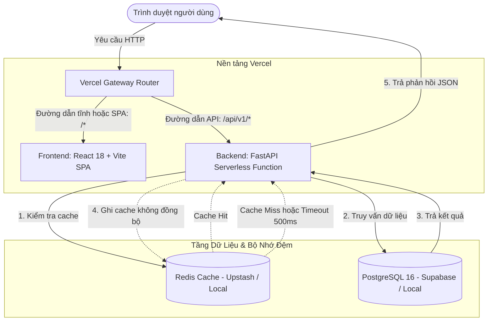

# Kiến Trúc Hệ Thống và Quyết Định Thiết Kế (Architecture & Design Decisions)

Tài liệu này trình bày chi tiết về luồng dữ liệu, cấu trúc module, các quyết định thiết kế cơ sở dữ liệu và chiến lược caching trong hệ thống G-Scores.

---

## 1. Sơ Đồ Kiến Trúc Tổng Thể



---

## 2. Thiết Kế Bảng Phẳng (Wide Table) cho Điểm Thi

### Hiện trạng và vấn đề
Tập dữ liệu điểm thi tốt nghiệp THPT 2024 có 1,061,605 thí sinh dự thi tối đa 9 môn học và 1 cột mã ngoại ngữ. Có hai hướng mô hình hóa quan hệ:

1. **Chuẩn hóa dọc (EAV / Normalized Table):**
   - Bảng `students` (`id`, `sbd`) và bảng `student_scores` (`student_id`, `subject_code`, `score`).
   - Tổng số bản ghi sinh ra: ~7.5 triệu dòng.
   - Nhược điểm: Để tính tổng điểm 3 môn Khối A (Toán + Vật lí + Hóa học), câu truy vấn buộc phải `JOIN` bảng `student_scores` 3 lần (hoặc dùng `GROUP BY` kèm `CASE WHEN`), gây chi phí lớn cho bộ nhớ và CPU khi sắp xếp trên tập dữ liệu lớn.

2. **Bảng phẳng (Wide Table - Lựa chọn thực tế):**
   - Bảng `students` gồm: `id`, `sbd`, `toan`, `ngu_van`, `ngoai_ngu`, `vat_li`, `hoa_hoc`, `sinh_hoc`, `lich_su`, `dia_li`, `gdcd`, `ma_ngoai_ngu`, `created_at`.
   - Tổng số bản ghi: đúng 1,061,605 dòng.

### Đánh giá và Trade-off
- **Ưu điểm:**
  - Thao tác bulk insert diễn ra nhanh hơn do chỉ tương tác trên 1 bảng duy nhất.
  - Tính tổng điểm Khối A (`toan + vat_li + hoa_hoc`) được thực hiện trực tiếp trên từng dòng dữ liệu mà không cần bất kỳ phép `JOIN` nào.
- **Nhược điểm (Chấp nhận được):** Tồn tại các giá trị `NULL` ở các môn thí sinh không dự thi (ví dụ thí sinh thi bài thi Khoa học Tự nhiên thì các cột Khoa học Xã hội là `NULL`). Với dữ liệu thi cử có cấu trúc cố định và không thay đổi theo thời gian, chi phí lưu trữ cho giá trị `NULL` trong PostgreSQL là không đáng kể (chỉ tốn bitmask trong tuple header).

---

## 3. Phân Tách Nghiệp Vụ Hướng Đối Tượng (OOP Domain Modeling)

Codebase phân tách rành mạch giữa mô hình ORM (SQLAlchemy), schema truyền nhận (Pydantic) và mô hình nghiệp vụ thuần túy (Domain Model):

```
backend/app/
├── domain/                  # Nghiệp vụ lõi (thuần Python, không phụ thuộc framework)
│   ├── models/
│   │   ├── subject.py       # Entity Subject: mã, tên, cột CSV, validate điểm
│   │   ├── exam_group.py    # Abstract ExamGroup và lớp cụ thể GroupA
│   │   └── registry.py      # SubjectRegistry quản lý danh mục môn học
│   └── rules/
│       └── scoring.py       # ScoreBand enum, phân loại 4 khoảng phổ điểm
├── models/                  # SQLAlchemy ORM mapped vào database tables
│   ├── student.py
│   └── statistic.py
├── schemas/                 # Pydantic v2 schemas phục vụ request/response validation
│   ├── student.py
│   ├── score.py
│   └── report.py
└── services/                # Điều phối giữa Domain, Repository và Cache
```

### Lợi ích kỹ thuật
- **Độc lập framework:** Logic phân khoảng điểm hay tính tổng tổ hợp Khối A được kiểm thử độc lập thông qua Unit Test mà không cần dựng database giả lập hay khởi động FastAPI instance.
- **Mở rộng linh hoạt:** Khi cần bổ sung tổ hợp môn mới (ví dụ Khối B: Toán - Hóa - Sinh, Khối C: Văn - Sử - Địa), hệ thống chỉ cần kế thừa lớp trừu tượng `ExamGroup` mà không ảnh hưởng đến cấu trúc bảng hiện tại.

---

## 4. Tối Ưu Truy Vấn với Bảng Thống Kê (Pre-aggregated Tables)

### Vấn đề
Dữ liệu kỳ thi THPT 2024 là **dữ liệu lịch sử (read-only)**. Việc quét lại 1,061,605 bản ghi mỗi khi có yêu cầu:
- Đếm tổng số thí sinh (`SELECT count(*) FROM students`)
- Thống kê 4 khoảng điểm của 9 môn học qua `CASE WHEN`
là lãng phí tài nguyên CPU của database server.

### Thiết kế
Hệ thống bổ sung 2 bảng chuyên biệt:
1. `system_metrics`:
   - `metric_key` (VARCHAR PK): ví dụ `"total_students"`.
   - `metric_value` (INTEGER): `1061605`.
   - `updated_at` (TIMESTAMP).
2. `score_statistics`:
   - `subject_code` (VARCHAR UNIQUE INDEX): mã môn học (`toan`, `ngu_van`, ...).
   - `ge_8`, `ge_6_lt_8`, `ge_4_lt_6`, `lt_4`: số lượng thí sinh theo 4 khoảng điểm.
   - `valid_count`: tổng số bài thi có điểm của môn.

### Cơ chế Fallback an toàn (Graceful Degradation ở tầng CSDL)
Trong `StudentRepository` và `ScoreRepository`:
```python
# Ví dụ logic tại ScoreRepository
stat = await StatisticRepository.get_score_statistic(session, subject_code)
if stat is not None:
    return stat  # Đọc nhanh từ bảng thống kê (1 dòng có index)

# Fallback: Quét conditional aggregation từ bảng gốc nếu chưa có thống kê
return await ScoreRepository.get_distribution_by_column(session, column_name)
```

---

## 5. Partial Functional Index cho Top 10 Khối A

### Vấn đề
Biểu thức tính tổng điểm 3 môn Khối A: `(toan + vat_li + hoa_hoc)`.
Trong hơn 1 triệu thí sinh, chỉ có 343,800 thí sinh dự thi đầy đủ cả 3 môn này. Nếu dùng index thông thường trên từng cột, PostgreSQL vẫn phải:
1. Quét tìm các dòng thỏa mãn điều kiện `toan IS NOT NULL AND vat_li IS NOT NULL AND hoa_hoc IS NOT NULL`.
2. Tính toán giá trị tổng điểm cho 343,800 dòng.
3. Thực hiện giải thuật sắp xếp (Top-N Sort) để lấy 10 dòng cao nhất.

### Giải pháp: Partial Functional Index
Tạo index trên chính biểu thức tính toán, kết hợp điều kiện lọc cục bộ:

```sql
CREATE INDEX idx_students_group_a_sum
ON students (
    (toan + vat_li + hoa_hoc) DESC,
    sbd ASC
)
WHERE toan IS NOT NULL
  AND vat_li IS NOT NULL
  AND hoa_hoc IS NOT NULL;
```

### Cơ chế hoạt động
- **Functional:** Cây B-Tree lưu sẵn giá trị tổng điểm đã tính trước theo thứ tự giảm dần.
- **Partial (`WHERE`):** Index chỉ đánh trên 343,800 dòng có đủ điểm 3 môn, giúp giảm dung lượng index trên đĩa và trong bộ đệm RAM (Shared Buffers).
- **Tie-break (`sbd ASC`):** Kết hợp số báo danh tăng dần ngay trong cấu trúc index.
- **Kết quả query plan:** Lệnh `EXPLAIN (ANALYZE, BUFFERS)` xác nhận truy vấn chuyển hoàn toàn sang `Index Scan using idx_students_group_a_sum` và dừng lại ngay khi đọc đủ 10 bản ghi (`LIMIT 10`), triệt tiêu hoàn toàn nút `Sort`.

---

## 6. Chiến Lược Caching Redis

### 1. Mô hình Cache-Aside
Hệ thống sử dụng lớp `CacheManager` tại `app/core/cache.py`:
- Khi có request: Backend kiểm tra Redis trước. Nếu có dữ liệu (Cache Hit), parse JSON và trả về ngay.
- Nếu không có (Cache Miss): Truy vấn PostgreSQL, serialize dữ liệu và lưu vào Redis kèm TTL.

### 2. Chính sách phân bổ khóa và TTL
- Tổng thí sinh: `students:total:v1`, TTL 24 giờ.
- Phổ điểm từng môn: `reports:distribution:v1:{subject_code}`, TTL 24 giờ.
- Top 10 Khối A: `students:top_a:v1:{limit}`, TTL 24 giờ.
- Key versioning (`v1`): Hỗ trợ vô hiệu hóa toàn bộ cache phiên bản cũ khi cập nhật logic nghiệp vụ mà không cần xóa từng key.

### 3. Graceful Degradation (Bảo vệ tiến trình API)
- **Timeout kết nối ngắn (500ms):** Ngăn việc tiến trình API bị giữ socket chờ đợi khi Redis gặp sự cố hoặc nghẽn mạng.
- **Bắt ngoại lệ an toàn:** Mọi lỗi kết nối (`RedisError`, `TimeoutError`, `OSError`) đều được ghi log dạng cảnh báo và trả về `None`, để ứng dụng fallback truy vấn PostgreSQL. API luôn trả kết quả chính xác thay vì lỗi HTTP 500.
